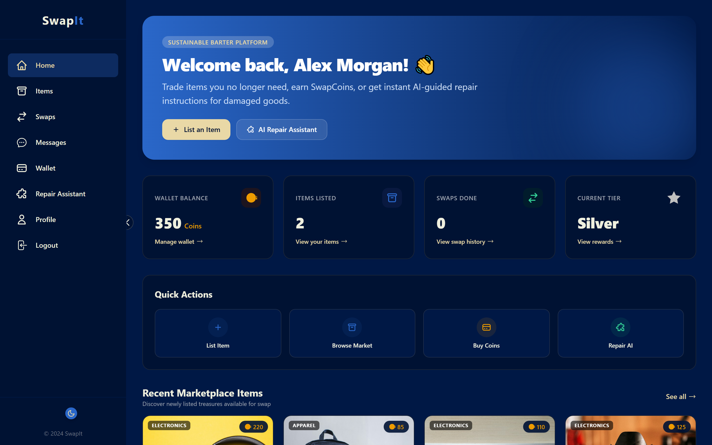
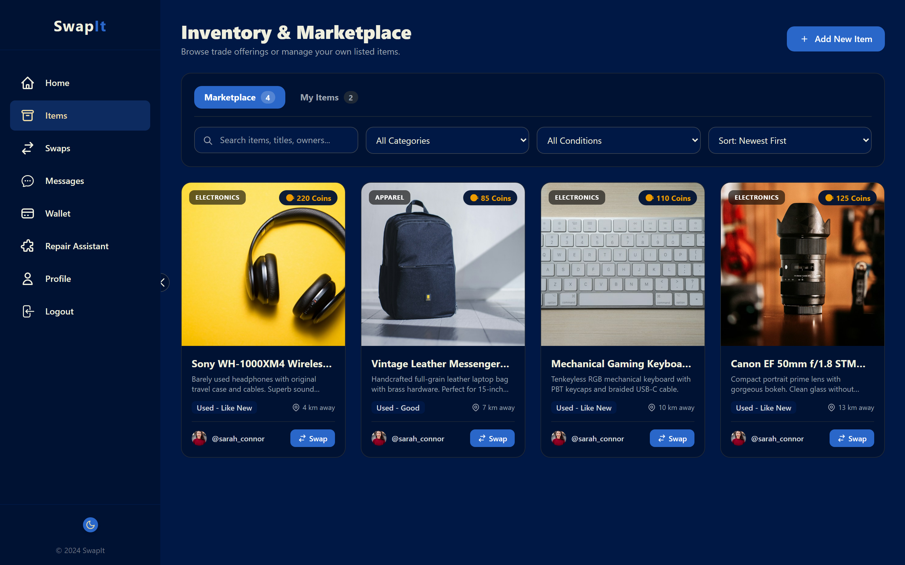
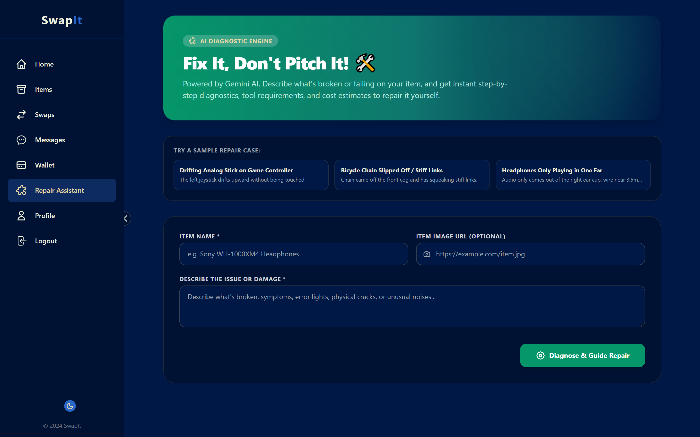
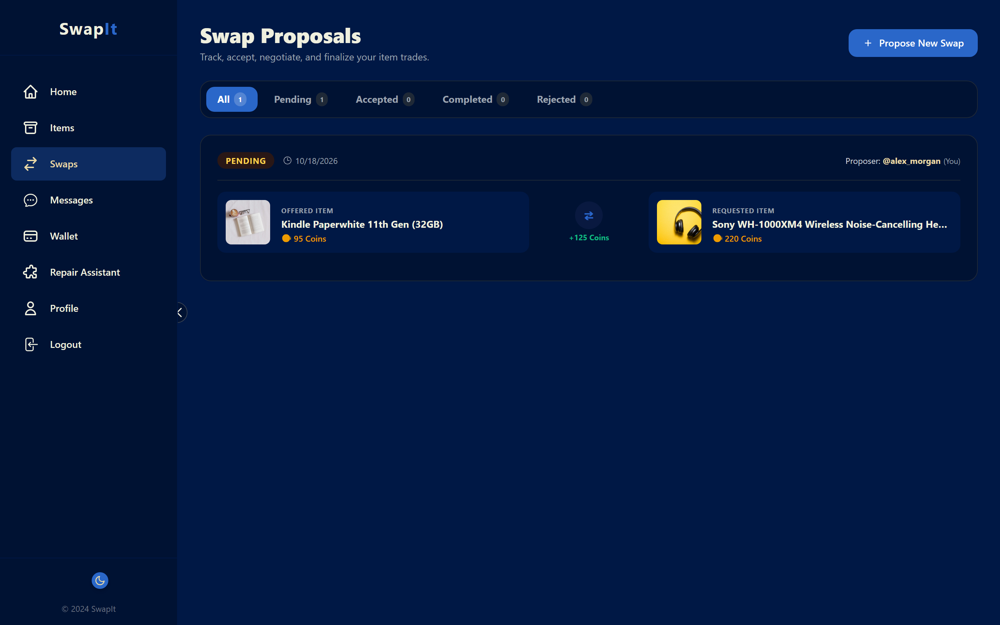
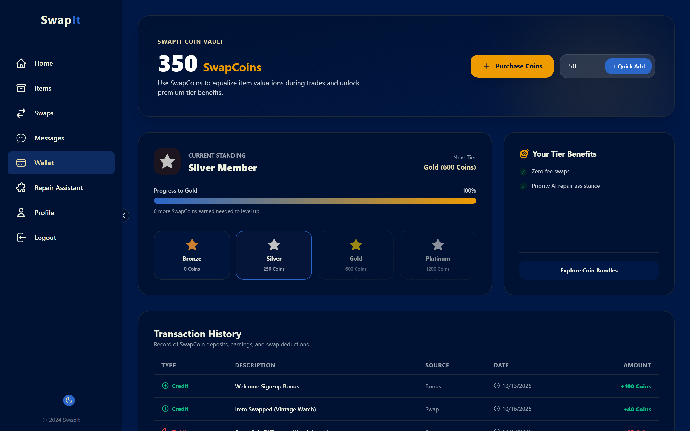
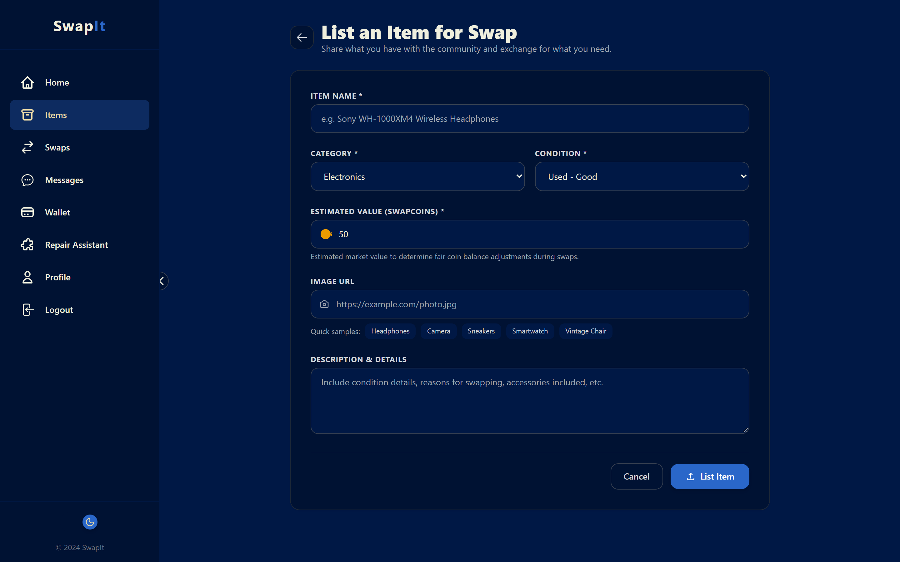
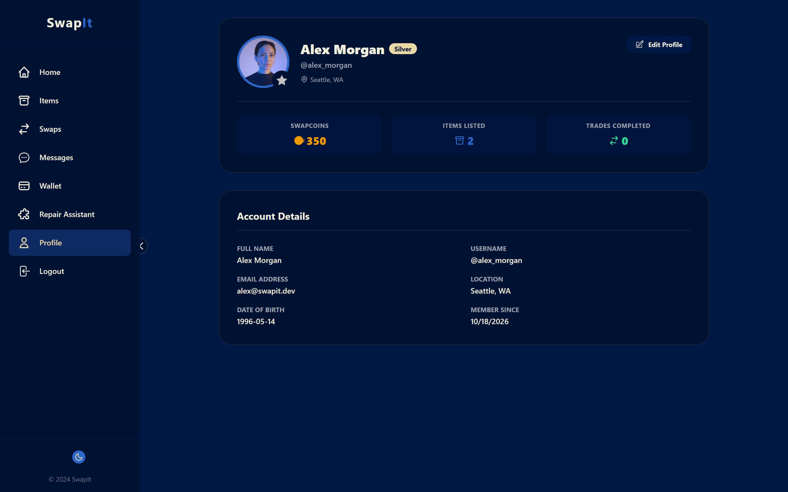
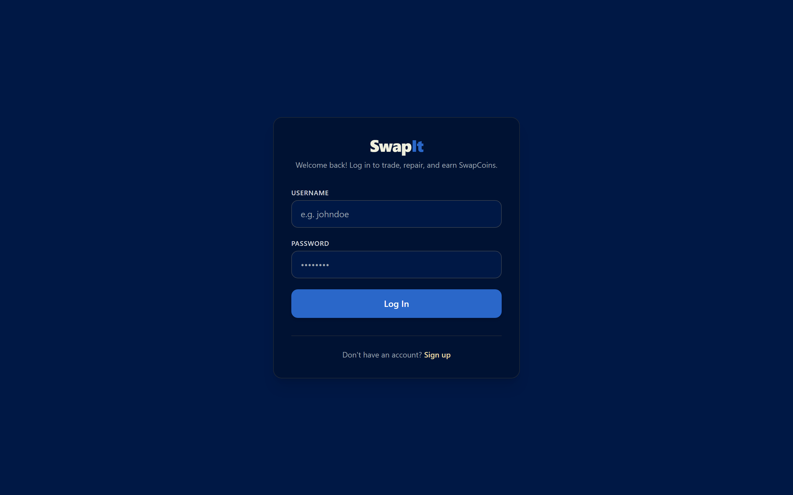
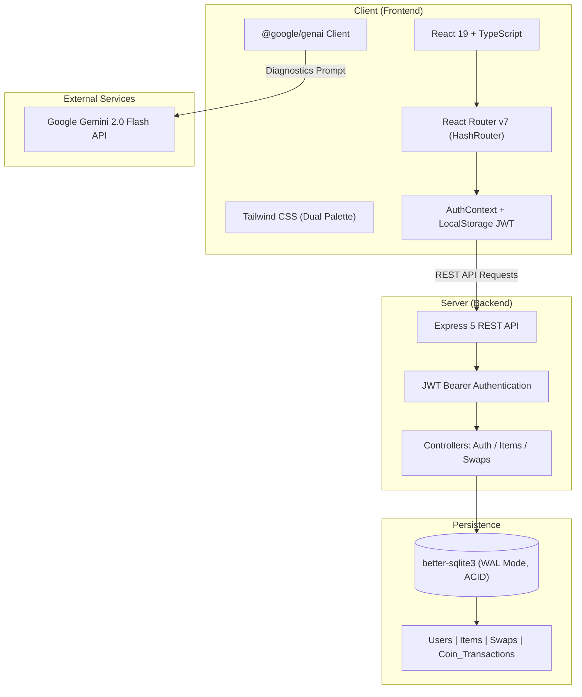

# <p align="center"><strong>Swap<span style="color:#2A67C9;">It</span></strong></p>

<p align="center">
  <strong>The Next-Generation Circular Economy & Community Barter Platform</strong><br>
  <em>Exchange pre-loved treasures, balance trade values with SwapCoins, and revive broken goods with Gemini-powered AI repair diagnostics.</em>
</p>

<p align="center">
  
  
  
  
  
  
  
  
</p>

---

## 🌟 Overview

In a world plagued by consumer waste and rapid obsolescence, **SwapIt** re-imagines commerce from the ground up. SwapIt is a full-stack, eco-conscious barter platform designed to foster a circular economy. Instead of discarding items or dealing with depreciated cash marketplaces, users can:

- **Directly swap belongings** peer-to-peer with members of their local community.
- **Fairly bridge valuation differences** using **SwapCoins**—a built-in reputation and incentive currency.
- **Diagnose and repair faulty items** using the integrated **Gemini AI Repair Assistant** before throwing them away.

Built with a modern reactive architecture (**React 19**, **Vite**, **TypeScript**, **Express 5**, and a zero-configuration high-concurrency **SQLite WAL** backend), SwapIt delivers a fluid, responsive experience in both light sand and midnight dark aesthetics.

---

## 📸 Platform Tour & Features

### 1. Unified Dashboard & Command Center
The personalized dashboard delivers instantaneous insight into your circular footprint: current **SwapCoin** balance, listed items, completed trades, and your community tier (Bronze ➔ Silver ➔ Gold ➔ Platinum).

<p align="center">
  
</p>

* **Quick Action Dock**: Direct shortcuts to list items, explore the community market, top up coins, or consult the AI repair engine.
* **Reputation Badging**: Automatic tier progression calculated dynamically from earned coins and active transactions.

---

### 2. Discover & Filter the Marketplace
Browse through pre-loved electronics, fashion, books, and collectibles offered by community members. Advanced multi-attribute filtering allows real-time sorting by category, condition, distance, and coin valuation.

<p align="center">
  
</p>

* **Granular Filters**: Search by item condition (`New`, `Used - Like New`, `Used - Good`, `Used - Fair`).
* **One-Click Swap Proposals**: Initiate an offer directly from any listing card without friction.

---

### 3. AI Repair Assistant — *"Fix It, Don't Pitch It!"* 🛠️
Why replace when you can restore? Powered by Google's **Gemini 2.0 Flash multimodal AI**, SwapIt acts as a pocket technician. Enter symptoms or item specifications, and the engine generates structured repair manuals in real time.

<p align="center">
  
</p>

* **Interactive Troubleshooting**: Step-by-step diagnostic breakdown with estimated difficulty, required tools, and safety warnings.
* **Incentivized Sustainability**: Encourages maintenance before disposal, reducing e-waste and carbon impact.

---

### 4. Transparent Negotiation & Swap Management
Keep full oversight over outgoing proposals and incoming trade offers. SwapIt evaluates item appraisals and displays the exact **SwapCoin differential** required to make every deal balanced and fair.

<p align="center">
  
</p>

* **Atomic Transactions**: Item ownership and coin balances transfer simultaneously within SQLite ACID database transactions.
* **Bidirectional Reviews**: Community accountability with built-in feedback loops.

---

### 5. SwapCoin Wallet & Micro-Economy
SwapCoins keep the barter ecosystem liquid and honest when items don't have identical market value. Earn coins by listing items, completing successful swaps, and participating in repair challenges.

<p align="center">
  
</p>

* **Real-time Ledger**: Full transaction audit trail (Credit / Debit) detailing swap settlements, bonus earnings, and purchases.
* **Tier Milestones**: Clear progress bar showing next unlocks for Silver, Gold, and Platinum status.

---

### 6. Effortless Item Appraisal & Listing
Listing an item takes under 30 seconds. Choose categories, specify condition, upload media URLs, and estimate value in SwapCoins.

<p align="center">
  
</p>

---

### 7. Profile & Community Identity
Custom profile management showcasing your location, contact details, trading history, and verified status.

<p align="center">
  
</p>

---

### 8. Frictionless Authentication & Security
Robust JWT authentication with bcrypt password hashing ensures all private details and trade operations stay secure.

<p align="center">
  
</p>

---

## 🏗️ Architecture & Technology Stack



### Frontend
* **Core Framework**: [React 19](https://react.dev/) & [TypeScript](https://www.typescriptlang.org/)
* **Routing**: [React Router v7](https://reactrouter.com/) with SPA HashRouter
* **Build System**: [Vite 6](https://vitejs.dev/) with hot module replacement (HMR)
* **Styling**: [Tailwind CSS](https://tailwindcss.com/) with native Light/Dark theme switching
* **AI Diagnostics**: Google Generative AI SDK (`@google/genai`)

### Backend
* **Runtime**: [Node.js](https://nodejs.org/) (ES Modules)
* **Web Framework**: [Express 5](https://expressjs.com/)
* **Security & Auth**: JSON Web Tokens (`jsonwebtoken`), `bcrypt` password hashing, configurable `cors`
* **Database**: [better-sqlite3](https://github.com/WiseLibs/better-sqlite3) with Write-Ahead Logging (`WAL`) mode for zero-latency local queries and atomic transaction rollbacks

---

## 🗄️ Database Schema Design

SwapIt utilizes an integrated SQLite schema designed for referential integrity:

| Table | Purpose | Key Attributes |
| :--- | :--- | :--- |
| **`users`** | User credentials, coins, and reputation | `id`, `name`, `username`, `email`, `password`, `coins`, `total_coins_earned`, `avatar_url`, `location` |
| **`items`** | Listed marketplace inventory | `id`, `owner_id` (FK), `name`, `description`, `image_url`, `condition`, `value`, `category` |
| **`swaps`** | Bilateral trade proposals and agreements | `id`, `proposer_id`, `receiver_id`, `proposer_item_id`, `receiver_item_id`, `status`, `coin_difference` |
| **`coin_transactions`** | Immutable financial audit ledger | `id`, `user_id` (FK), `type` (Credit/Debit), `description`, `amount`, `source`, `created_at` |

---

## 🚀 Getting Started

Follow these instructions to run the entire platform locally on your machine.

### Prerequisites
* **Node.js**: v18.0.0 or higher
* **npm**: v9.0.0 or higher
* **Google Gemini API Key** *(Optional, for AI Repair Assistant)*: Obtain free from [Google AI Studio](https://aistudio.google.com/)

---

### Step 1: Clone the Repository
```bash
git clone https://github.com/nirajgajula03/SwapIT.git
cd SwapIT
```

---

### Step 2: Configure & Start the Backend

1. Navigate to the backend directory:
   ```bash
   cd backend
   ```

2. Install backend dependencies:
   ```bash
   npm install
   ```

3. Setup environment variables:
   Create a `.env` file in `backend/` (or copy from `.env.example`):
   ```env
   PORT=5000
   JWT_SECRET=your_super_secret_jwt_key_here
   ```

4. Launch the server:
   ```bash
   npm start
   ```
   > The backend server will automatically initialize `swapit.db` with all tables and start listening on **http://localhost:5000**.

---

### Step 3: Configure & Start the Frontend

1. Open a new terminal and navigate to the frontend directory:
   ```bash
   cd frontend
   ```

2. Install frontend dependencies:
   ```bash
   npm install
   ```

3. Setup environment variables:
   Create a `.env.local` file in `frontend/` (or copy from `.env.example`):
   ```env
   GEMINI_API_KEY=your_gemini_api_key_here
   ```

4. Launch the development server:
   ```bash
   npm run dev
   ```
   > The application will be live at **http://localhost:3000**.

---

### Step 4: Seed Sample Data *(Optional)*
To instantly populate the marketplace with realistic items, demo accounts, and transactions:
```bash
cd backend
node seed-and-capture.js
```
Now sign in with:
* **Username**: `alex_morgan`
* **Password**: `demo1234`

---

## 🎨 Design Philosophy & Theme Colors

SwapIt is styled with a bespoke dual-palette designed to reflect sustainable, organic materials paired with modern tech:

| Element | Light Theme | Dark Theme |
| :--- | :--- | :--- |
| **Primary Background** | `#EFEFDE` *(Warm Linen / Cream)* | `#001845` *(Deep Midnight Blue)* |
| **Accent / Brand Primary** | `#2A67C9` *(Cobalt Electric Blue)* | `#2A67C9` *(Cobalt Electric Blue)* |
| **Text Primary** | `#001233` *(Deep Navy Slate)* | `#EFEFDE` *(Warm Linen)* |
| **Coin & Badge Gold** | `#E9D8A6` *(Polished Brass)* | `#E9D8A6` *(Polished Brass)* |
| **Attention / Highlights** | `#EE9B00` *(Warm Amber)* | `#EE9B00` *(Warm Amber)* |

---

## 🤝 Contributing

Contributions to SwapIt are welcome! Whether it is adding new features, optimizing queries, or reporting bugs:

1. **Fork** the project repository.
2. Create your Feature Branch: `git checkout -b feature/AmazingFeature`
3. Commit your changes: `git commit -m 'Add AmazingFeature'`
4. Push to the branch: `git push origin feature/AmazingFeature`
5. Open a **Pull Request**.

---

## 📄 License

This project is licensed under the **MIT License** — see the [LICENSE](LICENSE) file for details.

<p align="center">
  Made with 💙 for a cleaner, greener, and more connected world.
</p>
